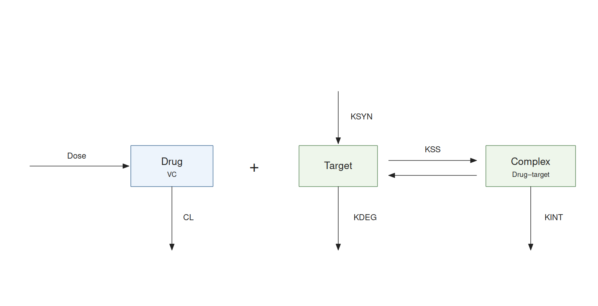
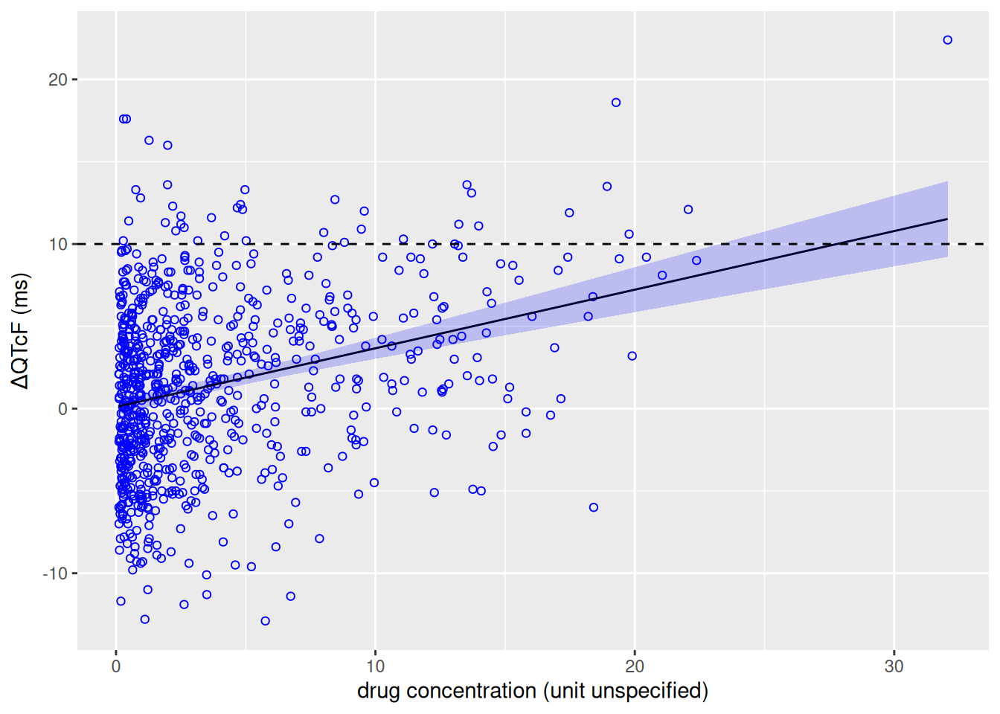

PMXWeave is an open-source pharmacometrics knowledge base and toolkit for AI agents. It supports authoring NONMEM and mrgsolve models, translating models from other software, drawing model structure diagrams, estimating parameters in R, and generating HTML and Word reports.

To get started, open the PMXWeave folder as your AI agent’s workspace.
To expand the NONMEM/mrgsolve library, simply add your model files to the corresponding template folder.

## Runtime setup

Agents can quickly draft models directly in chat without an R runtime. Report generation requires the R dependencies and a configured queue worker, which can run locally.
The core PMXWeave toolkit is under 2 MB. The `example/` folder is an optional download with sample data and example reports.

## Background jobs

Long-running R jobs run in the background. When the agent harness sends a completion notification, the agent can resume from saved progress. Use one observer per job and avoid redundant status checks or duplicate submissions.

## Performance and customization

By default, PMXWeave directs the agent to read only the knowledge base and the study directories you explicitly name. To customize these rules, ask the agent to edit `AGENTS.md`. Your agent application controls filesystem access and can use a local model or a supported online model API. 

CPU time for parameter estimation is the main factor in how long model-fitting
workflows take. The AI model's capabilities influence which base models it proposes
and how accurately it interprets the final results.

AI-generated results interpretation is experimental. Review it carefully against the underlying analysis before relying on it.

Direct interpretation of plots, including goodness-of-fit diagnostics and visual predictive checks, requires a model that can read images. A text-only model can summarize tables and structured results. Have a reviewer assess findings that depend on visual inspection.

You can adapt the instructions in `references/` to specify how the agent
screens models, accesses files, and generates reports.

## Example PK/PD prompts

### Output Nonmem control stream only in chat

```text
Nonmem code for 2 cmt PKPD turnover model with inhibitory effect on Kout, IV drug
```

### Generate reports from the supplied base model

```text
I have a PK/PD dataset in example/pkpd/. Start with stepwise covariate
modeling (SCM) using the supplied base_model.ctl. Fit the final model and
generate diagnostics. Produce the HTML report first, followed by the Word
report. Save all outputs in the study directory.
```

### Screen base models and generate reports

```text
I have a PK/PD dataset in example/pkpd/. Compare one- and two-compartment
IV PK models by pairing each PK structure with each of the following four
indirect-response PD models:

- Linear inhibition of KOUT
- Emax inhibition of KOUT
- Linear stimulation of KIN
- Emax stimulation of KIN

Set the candidate limit to eight and screen all eight combinations. Report
the fit status and, where available, the BIC for each candidate. Recommend a
base model based on BIC, fit quality, and scientific plausibility.

Run stepwise covariate modeling (SCM) from the selected base model, fit the
final model, and generate diagnostics. Produce the HTML report first, followed
by the Word report. Save all outputs in the study directory.
```

## Local report generation benchmark

The benchmark covered five synthetic studies, run one at a time.
Runtimes vary with the dataset, model complexity, and computing environment.
The test system had an AMD Ryzen 9 5900XT (16 cores, 32 threads), 125.7 GiB of DDR4 RAM
visible to Linux, and an AMD Radeon RX 7900 XTX with 24 GiB of VRAM.

Deepseek harness 0.2.0-rc.2 used Strata-rdna3 (Qwen3.8-Flash-Next with
UD-Q4_K_XL quantization), with reasoning set to Low. The R worker used R 4.5.1,
nlmixr2 7.0.1, nlmixr2est 7.1.0, rxode2 5.1.7.1, nonmem2rx 0.1.11,
mrgsolve 2.0.1, rmarkdown 2.32, Pandoc 3.8.2.1, officer 0.7.6, and flextable 0.10.1.

| Analysis | Start to Final HTML (min) | Start to Final Word (min) |
|---|---:|---:|
| Population PK | 34.2 | 42.7 |
| PK/PD | 20.8 | 24.3 |
| TMDD | 45.2 | 48.8 |
| Exposure–response | 10.9 | 10.9 |
| Concentration–QTc | 12.2 | 12.2 |

Reported times include agent preparation, R analysis, and any narrative
revisions. The local agent handled model fitting, results interpretation, and
recovery from simulator issues.

### Example figures

**TMDD model structure**



**Population PK — observed versus predicted concentration**


**Exposure-response — probability of objective response**




Contact: Jian Zhou
LinkedIn: https://www.linkedin.com/in/jian-zhou-a93533b9
