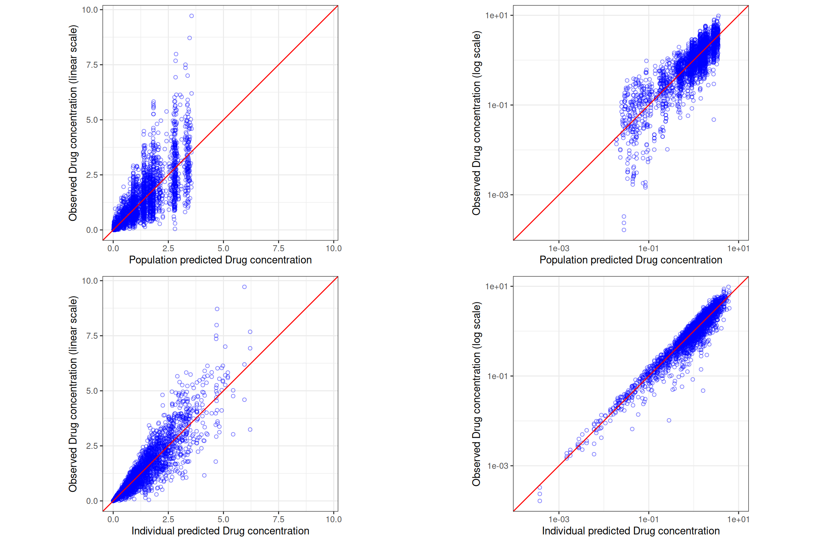
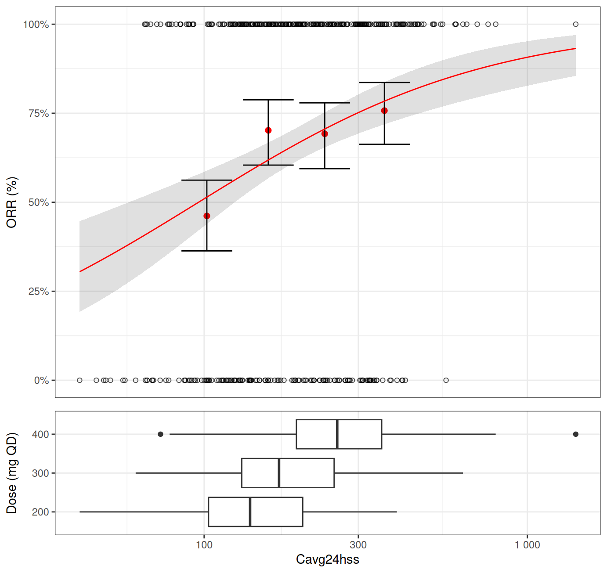

# PMXWeave

PMXWeave is an open-source knowledge base and toolkit for AI agents working
in pharmacometrics. It combines reusable instructions, NONMEM control-stream
and mrgsolve templates, and executable R workflows. Agents can draft NONMEM
control streams directly in chat, draw model structure diagrams, and use study
data to produce population PK, PK/PD, TMDD, exposure-response, and
concentration-QTc reports. Report templates for other model types can be added
as needed.

Agents can also prepare PsN SCM configuration files and bootstrap command
scripts for use with a licensed NONMEM installation and PsN.

Given a readable model file from another modeling application, the AI agent can
interpret its model definition and generate a corresponding NONMEM control
stream or mrgsolve model file.

Development testing used synthetic datasets with Qwen3.8-Flash-Next in
Q4_K_XL quantization and covered five analysis families.

## Workflow

For population-modeling analyses, the typical workflow is

**Data → base model → stepwise covariate modeling (SCM) → final model →
uncertainty estimation and diagnostics → HTML report → Word report with
limited AI-assisted data interpretation.**

Exposure-response and concentration-QTc analyses follow their corresponding
regression workflows.

Long R jobs run in the background. In Deepseek harness, completion notifications let the
agent continue from saved progress. Keep one observer per job and avoid
repeated status checks or duplicate submissions.

The agent can screen candidate base models using BIC, trying up to six models
by default; this limit can be adjusted in the rules as needed. However, model
screening can be computationally expensive. Users are encouraged to provide or
confirm the base model, including by describing it in a natural-language prompt,
and to review the data definitions and analysis settings. Starting from a
user-selected base model generally provides a more efficient workflow.

The current estimation backend uses nlmixr2/nlmixr2est with FOCEI. Supported
NONMEM-style control streams are translated through nonmem2rx into rxode2 models,
and mrgsolve supports simulation. Exposure-response and concentration-QTc
analyses use R regression and mixed-effects packages, including survival and
lme4. Figures and reports use ggplot2, rmarkdown, officer, and flextable.
See [third-party software](THIRD_PARTY_NOTICES.md) for attribution and dependencies.

The workflow could be extended to invoke a licensed NONMEM installation through
its command-line interface. This integration has not been tested and may require
NONMEM command templates to be added to the knowledge base. It would also require
an execution and result-reading adapter, together with validation of the
integrated workflow.

Agent-generated code, model choices, diagnostics, and report interpretations
require review by a pharmacometrician.

Use [INDEX.md](INDEX.md) to select the analysis and
[AGENTS.md](AGENTS.md) for agent instructions.

## Runtime setup

Chat-based model authoring needs no R runtime. Reports require R and the analysis
packages, a C++ compiler, Pandoc, Node.js, Python and a POSIX shell. Use the study/output
folder authorized by the user. Set up an R queue worker [locally or in Docker](analyses_template/tools/runtime_paths.md)
and set PMX_RUNTIME_CONFIG or the Git-ignored local runtime pointer. The setup
guide includes a connection check. Name the actual study
path in your prompt and ensure the host agent permissions allow it. The study
may be outside the current workspace; Deepseek harness Full Access requires no separate PMX
directory whitelist. Keep writes restricted to the requested output location.

## Performance and customization

By default, the workspace rules direct the agent to read only the knowledge
base and any study directory you explicitly name. You can ask your agent to
edit [AGENTS.md](AGENTS.md) to change those rules. Your agent application
controls actual filesystem access.

Use a local model or an online model API supported by your agent application.
Select the provider and model there.

For model-fitting workflows, overall analysis speed is primarily limited by
CPU-based parameter estimation. The AI model's capabilities influence candidate
base-model selection and the interpretation of final results.

The instructions in [references/](references/) can be updated to suit local
requirements and guide or constrain the agent's behavior, including limits on
model screening, file access and report-generation workflows.

## Synthetic examples

Each study folder contains the analysis data, data dictionary, configuration,
and completed Word report. The population PK, PK/PD, and TMDD examples also
include the base and final model files and covariate definitions.

| Analysis | Example study | Word report |
|---|---|---|
| Population PK | [PPK](example/ppk/) | [Report](example/ppk/ppk_report.docx) |
| PK/PD | [PK/PD](example/pkpd/) | [Report](example/pkpd/pkpd_report.docx) |
| TMDD | [TMDD](example/tmdd/) | [Report](example/tmdd/tmdd_report.docx) |
| Exposure-response | [ER](example/er/) | [Report](example/er/ER_report.docx) |
| Concentration-QTc | [c-QTc](example/cqtc/) | [Report](example/cqtc/CQTC_report.docx) |

To rerun an example, copy its study folder to a location available to your
configured R worker and follow the corresponding workflow in [INDEX.md](INDEX.md).

### Example figures

**TMDD model structure**

**Population PK — observed versus predicted concentration**

**Exposure-response — probability of objective response**

## License and software

Project-owned code and templates use the [MIT License](LICENSE).
Software attribution is in [THIRD_PARTY_NOTICES.md](THIRD_PARTY_NOTICES.md).
